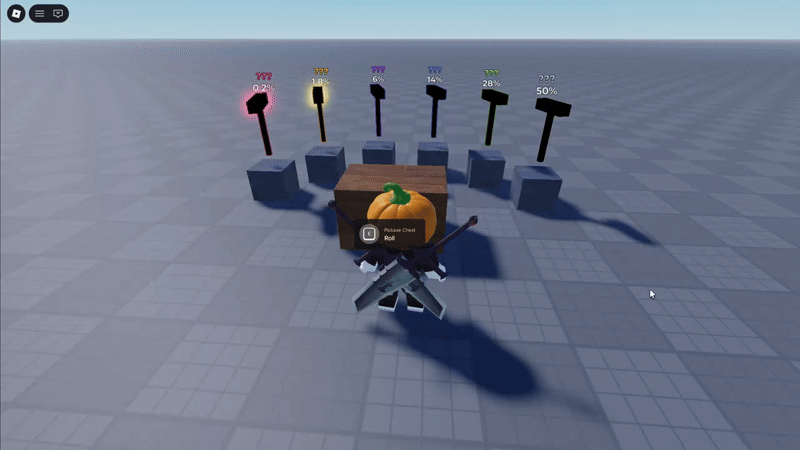

# Pickaxe Roll

Gacha-style pickaxe chest for Roblox, extracted from my game *Steal a Door*.



- Server rolls and saves, the client only stages the spin, so several players can roll at one chest at once
- The result reaches the collection and chat only after the reveal, so nothing spoils the spin
- The roll cooldown is the animation length; taking a pickaxe off a pedestal is validated on the server
- Data, tuning and scene contract are separate from the code that reads them

**Stack:** Knit, ProfileStore, Rojo, Wally, Selene, StyLua, `--!strict`

## Run

```sh
aftman install
wally install
rojo serve
```

Open an empty Baseplate, connect Rojo, press Play and walk up to the chest.
